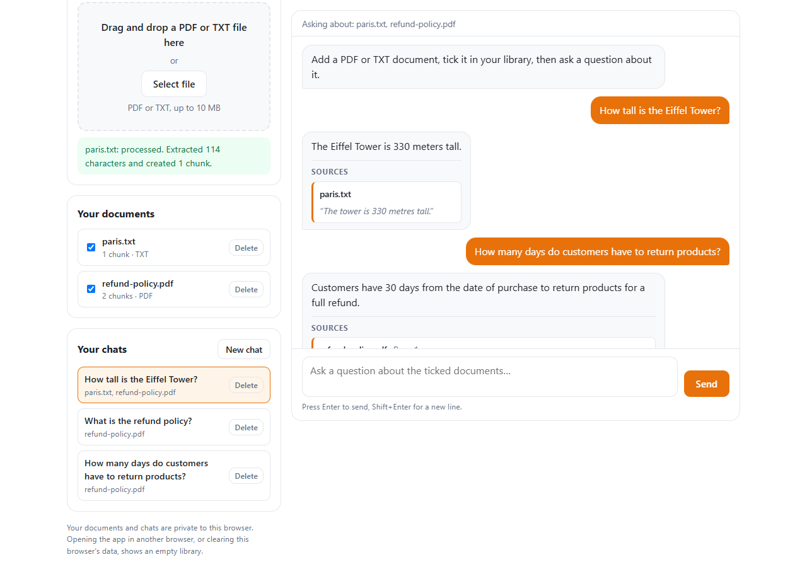

# NainOcular AI Assistant

A document-based AI chatbot. You add PDF or TXT files to your own private library, ask questions about one
or several of them, and get an answer together with the exact text it came from. If the documents do not
contain the answer, the assistant says so instead of guessing:

> I couldn't find this information in the uploaded documents.



## Features

- Add PDF or TXT files (max 10 MB), by button or drag and drop. Checked in the browser **and** on the server.
- Embeddings are stored in **Qdrant**, a real vector database, and the search runs inside it (with filters for your documents).
- A private **library** of your documents and a list of your **saved chats**. Close the browser, restart the
  backend, come back later: everything is still there, nothing needs to be uploaded again.
- Ask about **one or several documents at once** (up to 5). Reopen, continue or delete old chats.
- Answers use only the retrieved text, with source file, page number (PDFs only) and the exact excerpt.
- Every answer is verified by the backend before it is shown (see "Source citations").
- Each user only sees their own documents and chats (see "Who can see what").
- Clear loading states and error messages. Works on desktop and mobile.

## Screenshots

All screenshots are from a real run (real backend, MongoDB, Qdrant and AI).

| Screen | Image |
|---|---|
| Empty start screen | [01-initial-screen](docs/screenshots/01-initial-screen.png) |
| Unsupported file, refused in the browser | [02-unsupported-file-error](docs/screenshots/02-unsupported-file-error.png) |
| A corrupted PDF, refused by the server with a clear message | [03-server-rejection-error](docs/screenshots/03-server-rejection-error.png) |
| File selected, then being processed | [04-file-selected](docs/screenshots/04-file-selected.png), [05-processing](docs/screenshots/05-processing.png) |
| Document added to the library | [06-document-in-library](docs/screenshots/06-document-in-library.png) |
| Waiting for an answer (loading state) | [07-loading-answer](docs/screenshots/07-loading-answer.png) |
| **An answer with its source file, page and excerpt** | [08-answer-with-source](docs/screenshots/08-answer-with-source.png) |
| **A question the document cannot answer: the exact fallback sentence** | [09-fallback-answer](docs/screenshots/09-fallback-answer.png) |
| A saved chat reopened after the backend was restarted | [10-after-restart-reopened-chat](docs/screenshots/10-after-restart-reopened-chat.png) |
| Two documents ticked in one question | [11-two-documents-ticked](docs/screenshots/11-two-documents-ticked.png) |
| Network failure message | [12-network-error](docs/screenshots/12-network-error.png) |
| Phone layout | [13-mobile-top](docs/screenshots/13-mobile-top.png), [14-mobile-answer](docs/screenshots/14-mobile-answer.png) |
## Technology

| Part | Technology |
|---|---|
| Frontend | React 18, TypeScript, Vite, plain CSS |
| Backend | Node.js, Express, TypeScript, Multer (uploads), pdf-parse (PDF text) |
| Database | MongoDB (official `mongodb` driver): documents, chunk text, chats |
| Vector database | Qdrant (`@qdrant/js-client-rest`): the embeddings and the similarity search |
| AI | OpenRouter: an embedding model and a chat model |
| Security helpers | helmet, express-rate-limit, cors |

## Project structure

The project is small on purpose. Each file has one clear job, and the code inside is written in the order
the steps happen.

```
backend/
  src/
    server.ts      The web server. Lists the URLs (endpoints), security, who-is-asking check, error handling.
    documents.ts   DOCUMENT PROCESS: check the file, extract text, split into chunks, the upload workflow.
    chatbot.ts     QUESTION PROCESS: find similar chunks, ask the AI, verify the answer, save the chat.
    ai.ts          The only place that calls the AI provider (embeddings and chat), with retries.
    database.ts    The only place that talks to MongoDB: documents, chunk text, chats.
    vectors.ts     The only place that talks to Qdrant (the vector database): store, search and delete embeddings.
    helpers.ts     Tiny shared tools: error class, settings reader, ID and user-key checks, filename cleaner.
  tests/           Automated tests (chunking, integration, restart) and a fake AI used by them.
  .env.example     The names of the settings (copy it to .env and fill in the blanks).
frontend/
  src/
    App.tsx          Keeps the shared state (library, chats, open chat) and puts the pieces together.
    components.tsx   The building blocks: upload box, document list, chat list, messages, question box.
    api.ts           The data types, the private user key, and one small function per backend call.
    App.css          The styling (white, dark text, grey borders, one orange accent).
docs/screenshots   Real screenshots of the running app.
```

**Document process** (`documents.ts`, `uploadDocument()`): `detectFileType()` checks the file →
`extractText()` → `splitIntoChunks()` → `generateEmbeddings()` (in `ai.ts`) → `saveChunks()` (text, in `database.ts`) and `saveVectors()` (embeddings, in
`vectors.ts`) → `markDocumentProcessed()`.

**Question process** (`chatbot.ts`, `answerQuestion()`): check the request → `findRelevantChunks()` →
`generateAnswer()` → `verifyAnswer()` → `checkClaims()` → `saveConversation()` (in `database.ts`) →
return the answer and its sources.

## The RAG pipeline in simple English

RAG means "Retrieval-Augmented Generation": first **find** the relevant text, then let the AI **answer
from that text only**.

**When you add a document**
1. The backend checks the file (type, size, and that the content really is a PDF or text).
2. It creates a record in MongoDB with status `processing`.
3. It extracts the text (PDFs page by page, so each chunk can have a real page number). Special characters
   are cleaned up (for example the ligature "fi" becomes "fi").
4. It cuts the text into chunks of about 800 characters, overlapping by 100 so sentences are not cut off.
   A document may have at most 500 chunks.
5. Each chunk is sent to an embedding model. An **embedding** is a list of 1536 numbers describing the
   meaning of the text. Similar meanings give similar numbers.
6. The chunk **text** is saved in MongoDB and the **embeddings** are saved in Qdrant (one point per chunk, with the
   same ID, plus the owner ID and document ID used for filtering). Then the status becomes `processed`.
   If any step fails, the status becomes `failed` and partial data is removed from both.

**When you ask a question**
1. The question is turned into an embedding with the same model.
2. The backend asks **Qdrant** for the 5 chunks closest to the question, limited by a filter to **the documents you
   ticked** and **your** owner ID. Qdrant measures closeness with **cosine similarity**
   (`(a·b) / (|a|×|b|)`: 1 = same meaning direction, 0 = unrelated) using a vector index. It returns the chunk IDs and
   scores; the chunk text comes from MongoDB.
3. Chunks below `RETRIEVAL_MIN_SIMILARITY` are dropped. If none are left, the fixed fallback sentence is returned
   and the chat model is **not called**.
4. Otherwise the question and chunks go to the chat model, which must reply in JSON: an answer plus citations
   (chunk id + a quote copied from that chunk).
5. The backend verifies the reply (next section). Only a verified answer is shown and saved.

## Source citations: how they are produced and verified

The model proposes citations; the backend decides whether to trust them. An answer is shown only if:
- the reply is valid JSON in the expected shape;
- every cited chunk id is one of the chunks that was sent, **and belongs to one of the documents you ticked**;
- every quote really appears in the cited chunk (ignoring case, extra spaces, special characters, curly quotes and
  different dash characters, and at least 8 characters long);
- the filename, page number and chunk number come from the stored chunk, never from the model;
- a second model call says the quotes support the answer **and that the answer really responds to the question**.

The excerpt you see is the document's own text (found again inside the chunk), not the AI's retyped version.

If a check fails, the AI gets **one more try** and is told exactly what was wrong (for example, which quote was not
real text from the document). If the second try also fails, you see the fallback sentence plus a note.
Nothing unverified is ever shown as an answer.

The document text is treated as untrusted data: it is fenced in `<chunk>` tags and the prompt says to ignore
instructions inside it.

**Be honest about the limits:** these checks do not prove an answer is true. A quote can exist in the document and
still be misread. The last check is another AI model and can also be wrong.

## Who can see what (user separation)

There are no passwords. The first time a browser opens the app it creates a random **private key**
(64 hex characters) and keeps it in its `localStorage`. The key is sent with every request in the `X-User-Key`
header. The backend never stores the key itself, only a hash of it (the "owner ID"). Every document and chat
belongs to one owner ID, and every read, search, change and delete checks the owner ID. A request for someone
else's document or chat answers "not found" (404), so it does not even reveal that it exists. Two users who upload
the same file each get their own separate copy.

Good to know:
- A different browser, or cleared browser data, means a different (empty) library. There is no "log in on another device".
- Anyone who has the key can see that library. The key lives in the browser, so a malicious script running on the page
  would be able to read it. This is a simple privacy separation for a demo, **not** a replacement for real accounts.
  Do not use it for confidential documents.
- Documents and chats saved by an older version (before this feature) belong to nobody. They stay in the database
  but no user can see them. They can be removed in MongoDB if you do not need them.

## What MongoDB and Qdrant store

| Collection | Contents |
|---|---|
| `documents` | id, **ownerId**, filename, file type, status (`processing` / `processed` / `failed`), character and chunk counts, upload time, optional warning (for example "1 of 8 pages had no readable text") |
| `chunks` | id, document id, chunk number, text, filename, page number (PDF only). **No embedding** |
| `conversations` | id, **ownerId**, the document ids it is about, a title (the first question), created / updated time |
| `messages` | id, conversation id, role, text, answer status, verified sources, time |

**Qdrant** holds one point per chunk in the collection `nainocular_chunks` (vectors of 1536 numbers, cosine distance):
the point ID is the chunk ID, the vector is the embedding, and the payload has the `ownerId` and `documentId` (both
indexed, so filtered searches are fast). The two stores are separate, so before every question the backend checks that
Qdrant still holds all vectors of the chosen documents; if not (for example its storage folder was deleted) you get a
clear "missing from the search index, please upload it again" instead of a wrong "nothing found".

Good to know about the data:

- Unique indexes prevent duplicate chunks and a second "processed" copy of the same file for the same user,
  even when the same file is uploaded twice at the same moment.
- After a restart the backend reads everything from MongoDB and Qdrant (both keep their data on disk). An upload that was cut off by a crash is marked
  `failed` at startup instead of staying "processing" forever.
- A question and its answer are saved together, only after a successful answer. Failed AI calls save nothing.

## Edge cases that are handled

Uploads: empty, whitespace-only, fake-extension, binary, corrupted and scanned (no text) files; files over 10 MB;
text files in UTF-8, UTF-16 (older Windows "Unicode") and old Windows-1252 encodings; non-English filenames, very long
filenames and filenames containing markup (shown as plain text, never run); paths in filenames; the same file twice (also at the same moment); too many chunks (500) or
documents (20 per user); PDFs where only some pages have text (processed, with a warning); temporary AI provider
problems (up to 3 tries); a provider that is down, or answers with garbage (an empty answer, a wrong number of vectors, vectors of the wrong size,
text instead of JSON): a clear message and nothing saved; MongoDB down (clear 503, health check
shows it); a crash during processing.
Questions: empty, too long (1000 characters), wrong types, fake or foreign IDs, database-operator tricks, chunk tags
inside a question, more than 5 documents, a chat that does not match the ticked documents, a document or a chat deleted while
the answer was being made (nothing is saved, no orphan messages), a chat title that would be cut in the middle of an emoji, broken stored embeddings, very quick double clicks, switching chats while an answer is loading.
Frontend: pressing Enter while typing with an input method (Japanese, Chinese...) does not send half a word, a file over
10 MB is refused before sending, the same file uploaded twice, questions containing markup, a 400-letter word without spaces
on a phone screen, the backend being off, slow requests (2 minute timeout), a blocked `localStorage`, several dropped files,
long words and file names, small phone screens.

## Prerequisites

- Node.js 20 or newer
- MongoDB running locally (`winget install MongoDB.Server` on Windows starts it as a service on port 27017),
  or a free MongoDB Atlas connection string
- Qdrant (the vector database), see "Run Qdrant" below
- An OpenRouter API key (https://openrouter.ai/keys)

## Run Qdrant (the vector database)

Qdrant is a second program that must be running next to MongoDB.

**Windows, no Docker needed:** download `qdrant-x86_64-pc-windows-msvc.zip` from
https://github.com/qdrant/qdrant/releases (the latest release), unzip it into a folder such as `C:\qdrant`, and run:

```powershell
cd C:\qdrant
.\qdrant.exe            # keep this window open; it listens on http://localhost:6333
```

**With Docker:** `docker run -p 6333:6333 -v qdrant_storage:/qdrant/storage qdrant/qdrant`
**Cloud:** create a free cluster at https://cloud.qdrant.io, then set `QDRANT_URL` and `QDRANT_API_KEY` in `backend/.env`.

Qdrant keeps its data in a `storage` folder next to where it runs, so vectors survive restarts. Check it with
`curl.exe http://localhost:6333/collections`. The backend creates the collection itself the first time it starts.
If you change the embedding model (and so the vector size), use a new `QDRANT_COLLECTION` name.

## Setup

```powershell
cd backend
copy .env.example .env      # then open .env and fill in the blanks
npm.cmd install

cd ..\frontend
npm.cmd install
```

Use `npm.cmd` instead of `npm` if PowerShell says "running scripts is disabled".

Settings in `backend/.env` (never commit this file; `.env.example` lists the names only):

| Name | Meaning |
|---|---|
| `MONGODB_URI`, `MONGODB_DATABASE` | MongoDB address and database name |
| `OPENROUTER_API_KEY` | your key (required) |
| `OPENROUTER_MODEL` | chat model ID from https://openrouter.ai/models (required). Tested and recommended: `google/gemini-2.5-flash` |
| `QDRANT_URL`, `QDRANT_API_KEY`, `QDRANT_COLLECTION` | where Qdrant is (default `http://localhost:6333`), an optional key (cloud), and the collection name |
| `EMBEDDING_API_URL`, `EMBEDDING_API_KEY`, `EMBEDDING_MODEL`, `EMBEDDING_DIMENSIONS` | embeddings (key falls back to the OpenRouter key). `EMBEDDING_DIMENSIONS` is also the size of the Qdrant vectors |
| `RETRIEVAL_TOP_K`, `RETRIEVAL_MIN_SIMILARITY` | number of chunks, minimum similarity |
| `LLM_TEMPERATURE` | `0` = least random wording (does not guarantee facts) |
| `ENABLE_CLAIM_VERIFICATION` | `true` = the second check call |
| `MAX_CHUNKS_PER_DOCUMENT`, `MAX_DOCUMENTS_PER_USER` | limits that protect cost and storage |
| `PROVIDER_RETRY_DELAY_MS` | wait before retrying a failed AI provider call |
| `FRONTEND_ORIGIN` | the only website allowed to call the API (CORS) |
| `RATE_LIMIT_UPLOAD_PER_MINUTE`, `RATE_LIMIT_CHAT_PER_MINUTE` | request limits per IP |
| `TRUST_PROXY` | set to `1` when running behind a proxy or hosting service |

## Run

MongoDB (a Windows service) and Qdrant must be running first. Then use three terminals:

```powershell
# Terminal 0: Qdrant (see "Run Qdrant" above), leave it open
cd C:\qdrant
.\qdrant.exe

# Terminal 1: backend  -> http://localhost:5000
cd backend
npm.cmd run dev

# Terminal 2: frontend -> http://localhost:5173
cd frontend
npm.cmd run dev
```

Restart the backend after changing `.env`. Check it with `curl.exe http://localhost:5000/api/health`
(it also reports whether MongoDB and Qdrant are reachable). Ctrl+C stops the backend cleanly.

## API (all except `/api/health` need the `X-User-Key` header)

| Method and path | Purpose |
|---|---|
| `GET /api/health` | server, MongoDB and Qdrant status |
| `GET /api/documents` | the user's documents |
| `POST /api/documents/upload` | add a file (form field `file`) |
| `GET /api/documents/:id` | one document |
| `DELETE /api/documents/:id` | delete it with its chunks and chats |
| `POST /api/chat` | `{ question, documentIds: [...], conversationId? }` |
| `GET /api/conversations` | the user's chats, newest first |
| `GET /api/conversations/:id/messages` | the messages of one chat |
| `DELETE /api/conversations/:id` | delete a chat |

## Tests

```powershell
cd backend
npm.cmd run test:all        # build + all tests below
```
or separately: `npm.cmd run test:chunking`, `npm.cmd run test:rag`, `npm.cmd run test:persistence`.

| Test | What it covers |
|---|---|
| `test:chunking` | chunk size, overlap, order, page numbers |
| `test:rag` | Qdrant scores, filters and limits, retrieval and document scoping, moving old embeddings, a search index that lost data, Qdrant going down, **user separation**, multi-document questions, TXT and PDF upload, all the edge cases above, answers and the exact fallback, citation validation, provider failures, retries and garbage answers, MongoDB going down, text encodings (UTF-8, UTF-16, Windows-1252), odd file names, deleting a document or a chat while an answer is being made, chat history, security headers, ID and key validation, secrets not leaked, rate limiting |
| `test:persistence` | starts the real backend, **kills it**, starts a new one, and checks that documents, vectors in Qdrant, answers, chats and the library are still there, that old embeddings in MongoDB are moved to Qdrant at startup, that interrupted uploads are recovered, that another user sees nothing, and that the backend refuses to start without MongoDB or without Qdrant |

The tests live in `backend/tests`. They use a **local mock** in place of the AI providers (free and repeatable)
and a temporary MongoDB database and Qdrant collection that are deleted afterwards. They test our code, not the quality
of real AI answers, and they need MongoDB and Qdrant running.

The real interface was also checked in a real browser (Microsoft Edge) against the real AI, with the real backend, MongoDB
and Qdrant: adding files, errors, answers with sources, reopening chats after a backend restart, two documents in one
question, deleting, a second user, a file over 10 MB, markup in file names and questions (shown as plain text, never run),
input-method typing, network failure, and the mobile layout. That script is not part of this repository, so these checks
are described here, not reproducible from the repo. The screenshots in `docs/screenshots` come from that run.

### Tuning `RETRIEVAL_MIN_SIMILARITY`
The default `0.2` is a starting guess, not a proven value. With the test documents, questions about the document
scored about 0.2 to 0.7 and unrelated questions about 0.0 to 0.1. Upload a real document, ask about 10 questions it
answers and 10 it does not, read the `similarity` numbers in the API responses, and set the threshold between the groups.

## Security summary

- API keys stay in `backend/.env` (ignored by Git), are never sent to the browser, and are not logged.
- Every document and chat has an owner; the owner is checked on every request; other users' data looks "not found".
  The raw user key is never stored or logged.
- Uploads: 10 MB limit, type checked by content, filenames repaired and cleaned, files kept in memory (never on disk).
- IDs must be valid UUIDs and request fields must have the right type. JSON bodies are limited to 10 KB.
- Rate limits on upload and chat, `helmet` security headers, `Cache-Control: no-store` on all API answers,
  CORS for one origin.
- Error responses are short and safe: no stack traces, file paths or secrets. Logs contain only short messages.

## Known limitations

- **Simple identity, not real accounts.** The private key lives in the browser (see "Who can see what"). No password,
  no other devices, no recovery, and a script on the page could read the key. Add real accounts before anything confidential.
- **Slides, posters and tables are hard.** Their text is extracted as scattered fragments (for example "India imports",
  "Lithium" and "100%" on separate lines far apart), and no library setting fixes that. The AI sometimes cannot give an exact
  quote for such text, and then the app shows the fallback sentence instead of risking a made-up source. Normal text
  documents work much better. A stronger chat model helps (`gemini-2.5-flash` answered more of such questions than
  `gpt-4o-mini` in a small test).
- **Questions in another language than the document can score below the threshold.** For example, a Hindi question about an
  English document scored 0.16 against the default cut-off of 0.2, so it got the fallback sentence, while a Spanish one worked.
  Lower `RETRIEVAL_MIN_SIMILARITY` (and re-check with some unrelated questions) if you need that.
- **No OCR.** A fully scanned PDF is rejected with a clear message. A PDF with some scanned pages is processed without
  them and shows a warning.
- **Two stores can get out of step.** MongoDB (text) and Qdrant (vectors) are separate. Uploads clean up both on failure and every
  question checks that the vectors are there, but if Qdrant is down while a document is deleted, its vectors stay behind
  (harmless: nothing points to them, and every search is limited to existing documents).
- **Qdrant is one more program to run.** Without it the backend does not start.
- **No memory between questions.** Every question is answered on its own: earlier messages of a chat are shown but are not
  sent to the AI, so a follow-up like "and its height?" will not work.
- Verification reduces wrong answers but cannot guarantee correctness.
- Each question can use up to 3 AI calls (answer, retry, claim check), so allow about 3 to 8 seconds.
- Uploading waits for all embeddings in one request (a few seconds for normal documents, longer for 500 chunks).
- Rate limits are per IP address and kept in memory (they reset when the backend restarts).
- Quality scores (such as RAGAS) are not part of this project.

## Troubleshooting

| Problem | Fix |
|---|---|
| `npm : running scripts is disabled` | use `npm.cmd`, or run `Set-ExecutionPolicy -Scope CurrentUser RemoteSigned` once |
| Backend says "connecting to Qdrant ... failed" | start Qdrant (see "Run Qdrant") and check `QDRANT_URL` |
| "... is missing from the search index" | Qdrant lost its data (for example its storage folder was deleted). Upload that document again |
| Backend says the Qdrant collection has a different vector size | the embedding model changed. Use a new `QDRANT_COLLECTION` name |
| Backend says "connecting to MongoDB failed" | start MongoDB (Windows: `Start-Service MongoDB` in an administrator PowerShell) and check `MONGODB_URI` |
| Upload fails with "not configured" (503) | fill in `OPENROUTER_API_KEY` and `OPENROUTER_MODEL` in `backend/.env`, then restart the backend |
| Browser shows "Could not reach the server" | the backend is not running, or `FRONTEND_ORIGIN` does not match the page address |
| My old documents are gone after updating | they were saved before user separation and belong to nobody now. Upload them again |
| The library is empty in another browser | by design: each browser has its own private key |
| `EADDRINUSE` / port already in use | an old backend is still running: close its terminal, or change `PORT` |
| Always "I couldn't find this information" for good questions | lower `RETRIEVAL_MIN_SIMILARITY` (see tuning above) |
| "Too many requests" | wait a minute, or raise the `RATE_LIMIT_*` values |
| "You already have 20 documents" | delete a document you no longer need, or raise `MAX_DOCUMENTS_PER_USER` |
| "The AI provider returned an error (429 or 402)" | OpenRouter's limit: new accounts have low request limits (429) or too few credits (402). Wait, add credits, or pick another `OPENROUTER_MODEL` |
| "The AI's answer could not be verified" | the checks rejected the AI's answer (see "Source citations"). Try rephrasing, or use a stronger `OPENROUTER_MODEL` |
